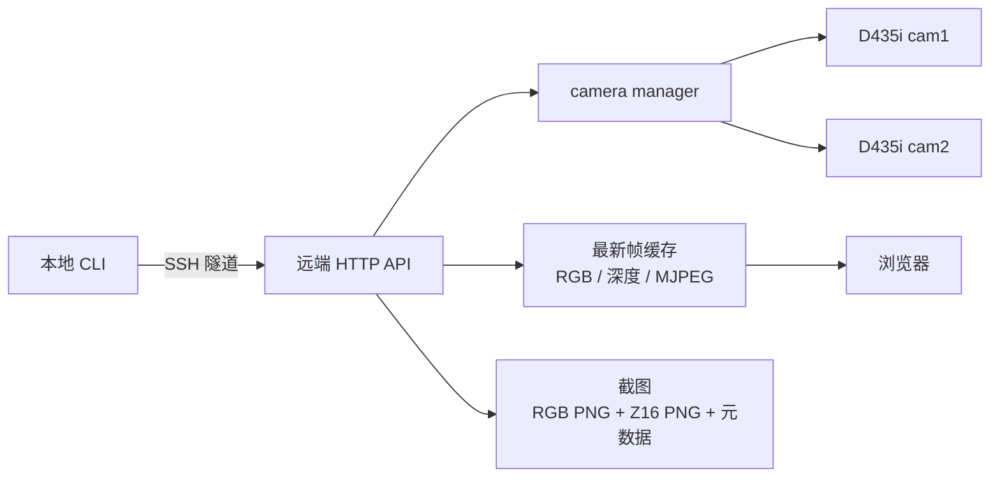

# 架构与数据流

camera-realsense-d435i 在连接相机的 Linux 主机上运行采集服务，在控制电脑上
提供只依赖标准库的客户端。控制电脑不需要安装 RealSense SDK，也不直接打开
相机。

## 组成

| 模块 | 职责 |
| --- | --- |
| `cli.py` | 本地/远端命令入口；客户端不导入 SDK |
| `client.py` | HTTP 请求与 SSH 隧道 |
| `server.py` | loopback HTTP API 与命令执行 |
| `manager.py` | 单一 pipeline、帧缓存、订阅者共享 |
| `camera.py` | pyrealsense2 设备、profile、截图与元数据 |
| `web.py` | 浏览器页面 |

## 生命周期

1. 本地 `connect`/`preview` 建立 SSH 隧道，并按需启动远端 unit。
2. `start` 打开所选相机的 pipeline，缓存最新 RGB 和深度帧。
3. 多个浏览器连接共享缓存，不为每个查看者重复打开设备。
4. `stop` 释放设备，API 保留在 idle。
5. `disconnect` 只关闭隧道；`stop_camera.sh` 停止服务并清理隧道。

## 数据语义

- MJPEG 是预览格式，不能用于测量或训练。
- 截图保存原始 Z16 16 位 PNG、`depth_scale`、内参、外参、帧号和时间戳。
- 未对齐时 RGB 与深度像素不一一对应。
- 设备时间与主机 monotonic 时间不得混用。
- 当前不是双机硬同步，也不是与机械臂同步采集。
